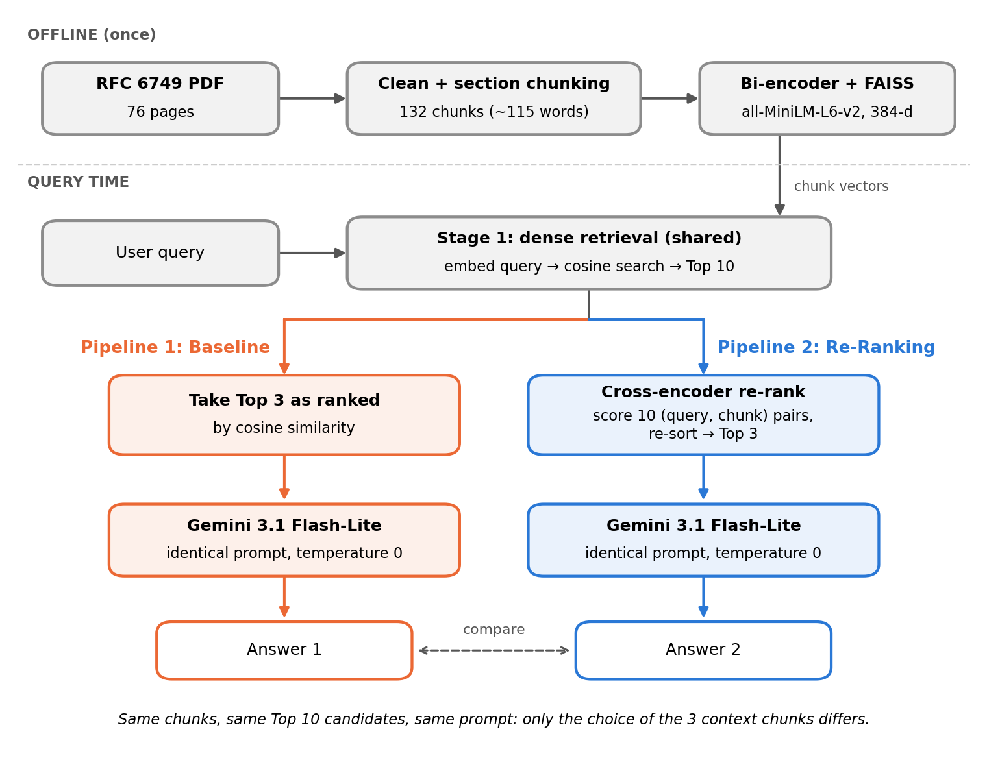
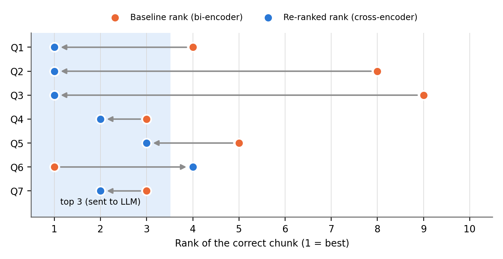

# RAG: Bi-Encoder Baseline vs. Cross-Encoder Re-Ranking

This repo compares two retrieval pipelines over the same chunked document:

- **Pipeline 1 (baseline):** a bi-encoder (`all-MiniLM-L6-v2`) and a FAISS index retrieve the top 10 chunks by cosine similarity. The top 3 go to the LLM and produce **Answer 1**.
- **Pipeline 2 (re-ranking):** the same top 10 are re-scored by a cross-encoder (`cross-encoder/ms-marco-MiniLM-L-6-v2`). The new top 3 go to the LLM with the identical prompt and produce **Answer 2**.

LLM: Google Gemini (`gemini-3.1-flash-lite`).



## Dataset
**RFC 6749: The OAuth 2.0 Authorization Framework** (IETF), 76 pages. It's a technical specification full of MUST / MUST NOT rules, exceptions and grant-specific constraints.
`data/RFC6749_OAuth2.pdf` is rendered page-for-page from the official RFC Editor text ([rfc6749.txt](https://www.rfc-editor.org/rfc/rfc6749.txt)), which is included in `data/source/`.

## Repository contents
| Path | Contents |
|---|---|
| `RAG_Baseline_vs_Reranking.ipynb` | The full notebook: cleaning, chunking, both pipelines, stress tests, latency, scaling, observations (with outputs) |
| `Report.pdf` | The report: architecture comparison, rank-shift analysis, latency, scaling |
| `data/` | The dataset PDF and its official source text |
| `results/stress_test_summary.csv` | Rank of the correct chunk before and after re-ranking, plus Answer 1 and Answer 2 for each test query |
| `results/latency.csv` | Latency per stage |
| `results/figures/` | Report figures |

## Results
| | Pipeline 1 | Pipeline 2 |
|---|---|---|
| Correct answers (7 stress-test queries) | 3 / 7 | 6 / 7 |
| Retrieval latency (mean, CPU) | ~12 ms | ~641 ms |

In 4 of the 7 queries, the correct chunk moved from rank 4–9 into the top 3 (average 6.5 → 1.5). In one query, re-ranking pushed the correct chunk out of the top 3. See the notebook (Section 10) and `Report.pdf` for the full analysis.



## How to run
```bash
pip install pymupdf sentence-transformers faiss-cpu google-genai pandas
export GEMINI_API_KEY="your-key"        # free key: https://aistudio.google.com/apikey
jupyter notebook RAG_Baseline_vs_Reranking.ipynb   # Run All
```
The key is read from the environment and is never stored in the notebook. Without a key, retrieval and re-ranking still run, and only the LLM answers are skipped.
